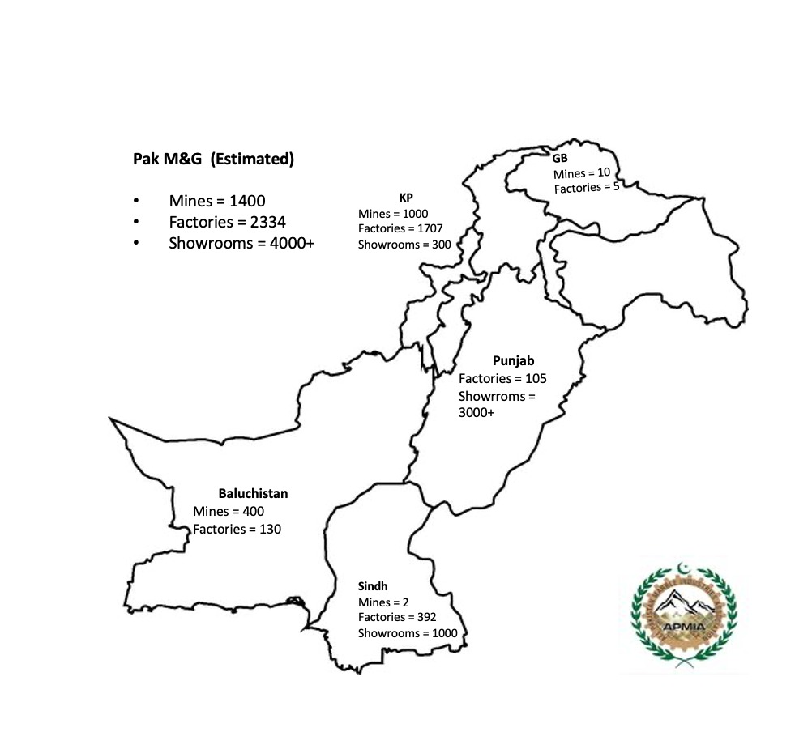
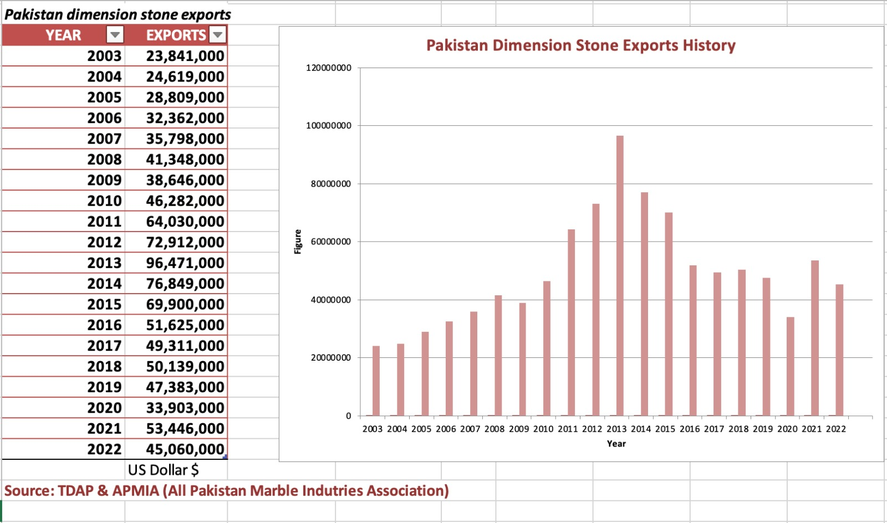

**Established in 1985**, the All Pakistan Marble Industries Association (APMIA) serves as the pivotal link connecting government bodies and industry stakeholders in the dimension stone sector. Recognized as the exclusive registered association by the Directorate General of Trade Organizations (DGTO) under Pakistan's Ministry of Commerce, APMIA proudly represents the entire dimension stone value chain, including marble and granite. This encompassing representation spans crucial areas such as mining, transportation, processing, showrooms, and exports.

With a nearly four-decade legacy, APMIA consistently demonstrates its commitment to addressing industry challenges while actively contributing to sectoral growth. Over the years, APMIA has adeptly navigated intricate matters, including negotiations on tax-related issues like GST, customs, and royalties. In a significant milestone, APMIA played a pivotal role in establishing the Pakistan Stone Development Company (PASDEC) in 2006, championing the advancement of the dimension stone sector.

Beyond its advocacy and regulatory roles, APMIA proactively drives industry progress. It organizes seminars, conducts training programs, and hosts expos that empower stakeholders with knowledge and insights essential for success in the dynamic dimension stone sector. Furthermore, APMIA fosters collaboration with academia and partners with relevant local and international organizations, providing access to cutting-edge research, technology, and global best practices. These initiatives bolster the industry's competitiveness and enduring growth.

As the authoritative voice of the sector, APMIA remains steadfast in its mission to promote collaboration, advocate for industry interests, and facilitate sustainable growth. Its unwavering dedication aligns with Pakistan's economic objectives and development aspirations, positioning APMIA as an indispensable driver of prosperity and success in the dimension stone sector.

