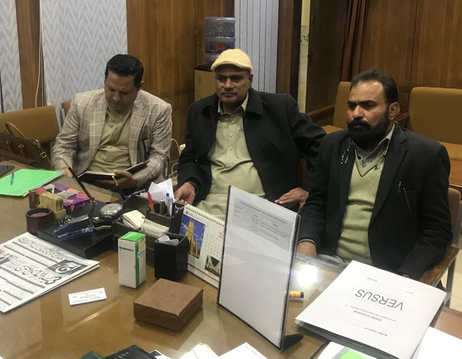

A meeting was held at Directorate General of Mines & Minerals, KPK between Mr. Muhammd Bilal Khan, Senior Vice Chairman APMIA and Mr. Saleem Mughal, Chairman Founder Group APMIA with DG Mines and Minerals Mr. Muntazir Khan in Peshawar, KPK. Theytook the initiative and tried to bridge the gap between KP mineral department and other group. Numerous pending leases will granted and issues which were raised at civil courts from both ends will be resolved through our good offices. Our first round of meeting was very promising with DG mines and his team and he pledged to resolve these matters soon. DG Mines & Minerals, KPK also promised to start a marathon of mining-committee in order to either grant or reject 5000 mining related long pending cases. Other group promised to join us and our APMIA forum. Indeed it will be a big achievement on behalf of APMIA if we conclude this deal between the two opponent groups.

