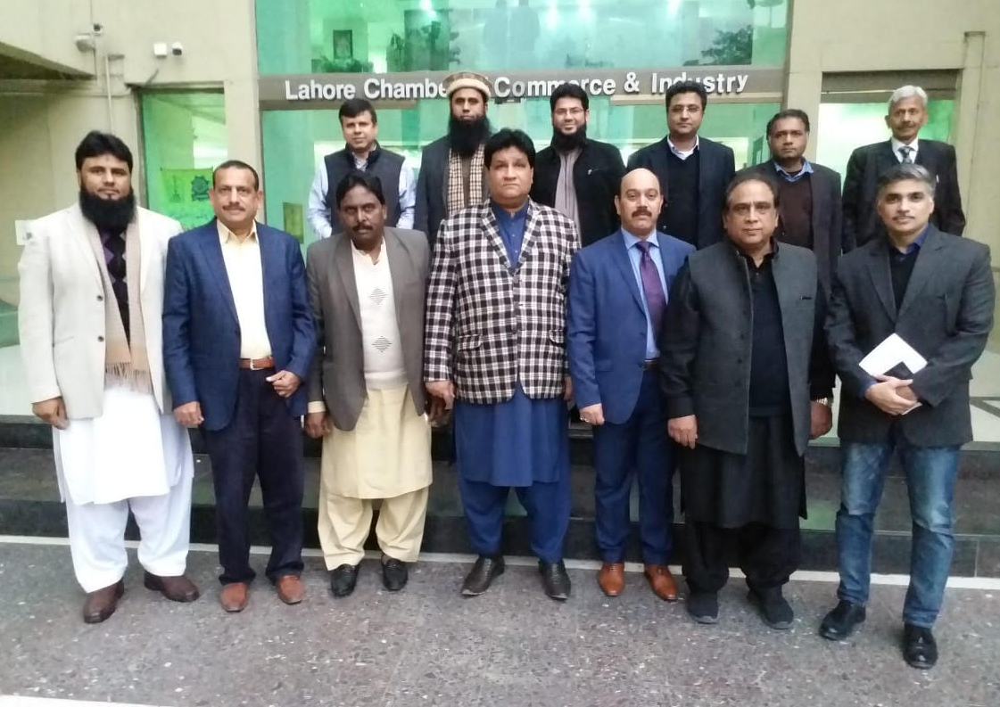

A meeting was held at LCCI on Friday with Chairman APMIA Mian Gulzar Ahmad, Vice Chairman Sheikh Iftikhar Rashid, CEC Members including Obaid Sultan and Mazhar Hussain, Ex Vice Chairman Zubair Bhatti, Javed Hayat, Abdul Rasheed including Khadim Hussain (Convener LCCI), Amir Saeed (Co-convener LCCI) regarding import values. The values were decided to present in customs house Karachi on 10 January 2019, with the mutual consent of APMIA representatives, importers and stakeholders.

