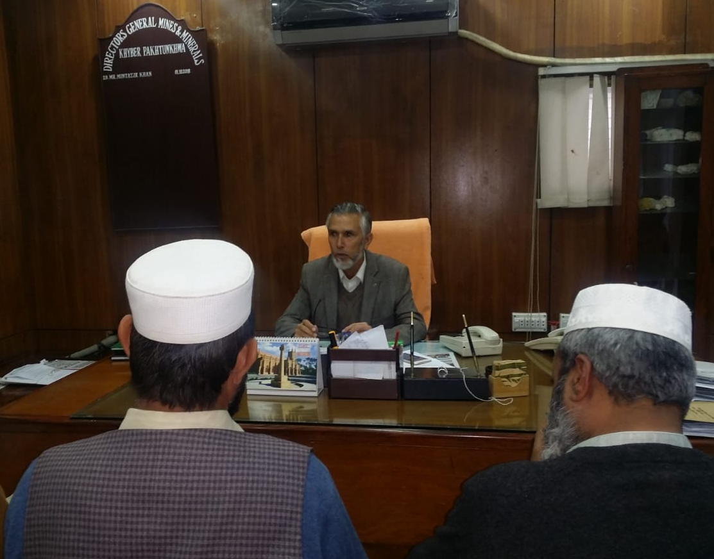

A meeting was held today between Mr. Muntazir Khan, DG Mines & Minerals, KPK and APMIA Executives including Mr. Shakir Ullah, Mr. Muhammad Sabir Khan and other mine owners from FATA region.  
 The problems regarding Challan books have been resolved and Challan books are issued to the mine owners. DG Mines has assured that he will fully support the mine owners of KPK in future.

