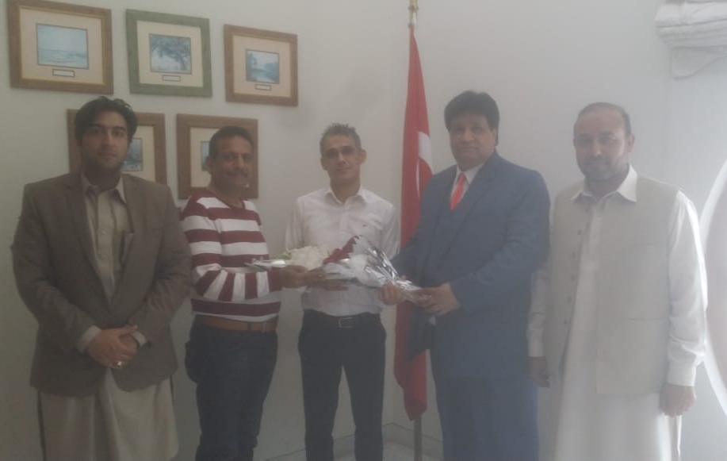

A meeting was held between Mr. Mian Gulzar Ahmad, Chairman APMIA, Mr. Sheikh Iftikhar Rasheed, Vice Chairman APMIA, Mr. Muhammad Sabir Khan, Member Executive Committee APMIA and Mr. Muhammad Qasim, Deputy Secretary APMIA with the Commercial Counselor Mr. Demir Ahmet in Embassy of Turkey, Islamabad.

