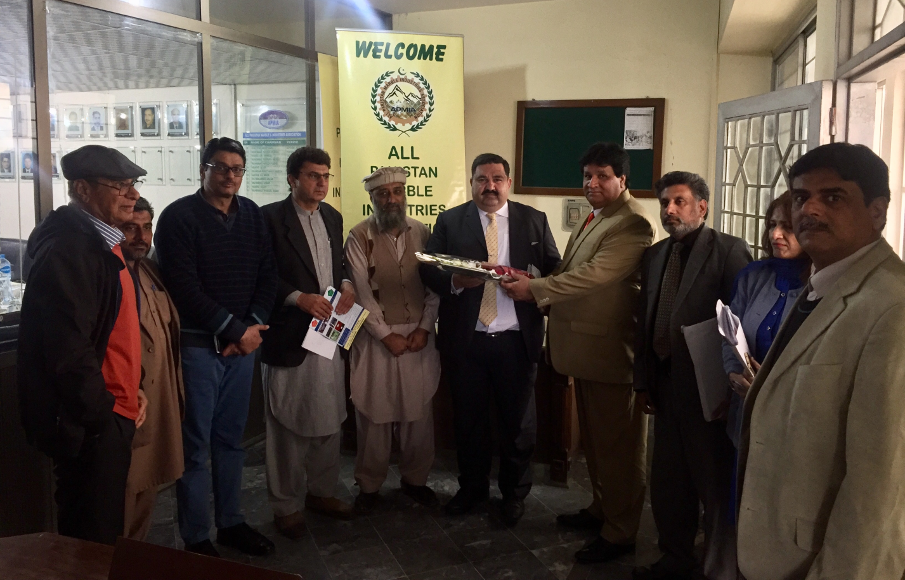

A meeting of APMIA representatives including Mr. Mian Gulzar Ahmad (Chairman APMIA), Mr. Muhammad Shakeel Munir (Former Chairman APMIA), Mr. Farrukh Majeed, Mr. Arshad Mehmood, Mr. Muhammad Sabir Khan, Mr. Shakir Ullah Khan (Executive Committee Member, Mr. Syed Masud Gillani (Secretary General-APMIA) and Mr. Muhammad Qasim (Deputy Secretary-APMIA) with the representatives of SME Bank Limited including Mr. Muhammad Sheharyar, Mr. Sohail Afzal, Mr. Muhammad Riaz, Miss Tahira Shaheen at APMIA Head Office, Islamabad. Mr. Muhammad Rasheed from REAP, RH Solar Energy, Islamabad was also available in the meeting.

The points which were discussed and highlighted by the APMIA representatives in the meeting are hereunder;

1. Mr. Mian Gulzar Ahmad told that as the export of marble of Pakistan is decreased from 140 million to 34 million so APMIA is specifically focusing on increasing the export of marble which can be increased when mechanize mining will be implemented.
1. Pakistan has the 3rd largest reserves, which can help in economical and employment growth only the support from government is required.
1. Mr. Muhammad Shakeel Munir mentioned that government should take APMIA in loop for the betterment of our sector and APMIA can provide the information regarding the marble / granite reserves of Pakistan. Furthermore, he mentioned that mining and extraction of black granite in Pakistan are working as oxygen for our industry.
1. To identify the issues of quarry and we should take the initiative from quarry to develop a strong value chain.
1. He further proposed to arrange next meeting of SME Bank in Shabqadar, Charsadda with the mine owners and industrialists and the next meeting should be arranged in Karachi.
1. Mr. Farrukh Majeed mentioned that there are 200 types of marble and granite in Pakistan and as Indian government in facilitating their mine owners, Pakistan government should also support our mine owners to promote our industry and government should provide the loan to the mine owners as well.
1. PASDEC model can be made and to take PASDEC in loop as well and if mines are operational, operational growth can be made easily and to make such package in which our industry can grow. Action plan should be made by APMIA and SME Bank mutually.
1. Mr. Shakir Ullah told that Mohmand Marble City is under construction to increase the production. Furthermore, he told SME Bank representatives advance machinery is required in mining to cover the lack of export.
1. Mr. Muhammad Sabir Khan mentioned that SME Bank should provide the maximum grace period so the installation process of the machinery can be made easily and he proposed to give the grace period should be from 9 to 12 months.
1. Latest machinery is a major factor which can strengthen marble industry and our industry can become the backbone of our country.
1. Electricity is a very major issue, as generator is not feasible so we should make such mechanism in which electricity issue can be reduced.

Following were the points mentioned by the representatives of SME Bank are as follows;

1. Mr. Muhammad Sheharyar told APMIA representatives that we should form a cluster for the correspondence and to work as a team to promote modernization in mining.
1. SME Bank can provide the working capital and loan can be provided to APMIA and they can provide the investment to the deserving members, if the association can provide guarantee to the SME Bank. The service charges of the loan are 6 percent.
1. All this working is for enhancing export of our country and the interaction of SME Bank and APMIA is a very positive sign.
1. To utilize SME Bank in a positive manner and he further agreed to conduct the next meeting in Shabqadar, Charsadda with the mine owners and industrialists.
1. Mr. Muhammad Rasheed from REAP, RH Solar Energy, Islamabad mentioned that solar services can be provided to the industrialists in order to avoid electricity issues and to make the smooth procedure of processing the marble.

6. He told APMIA and SME Bank representatives that the area of 6 sqm is required for 1 KV unit in which unit exchange mechanism is implemented between solar and grid station.

