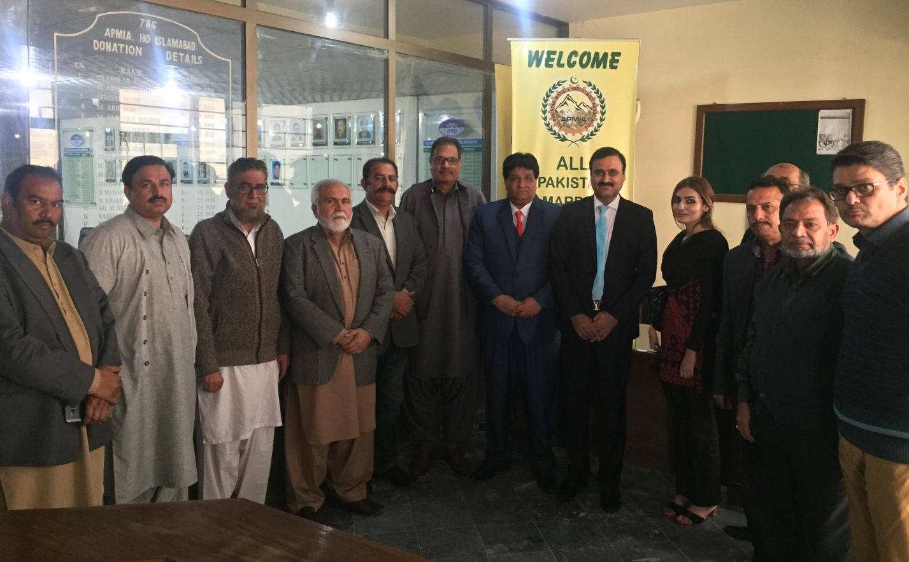

A meeting of APMIA representatives including Chairman APMIA Mian Gulzar Ahmad, Vice Chairman Sheikh Iftikhar Rasheed, Zonal Vice Chairman Muhammad Afzal Shahid, Former Chairmen Sohail Khan Babar, Mian Abdul Sami, Muhammad Shakeel Munir, Ilyas Muhammad and senior members Farrukh Munir, Agha Shahid, Sheikh Younas, Shahid Mehmood with Trade Development Authority of Pakistan (TDAP) Director Muhammad Owais Khan, Deputy Director Muhammad Tariq.

The points which were highlighted by APMIA’s representatives are as under,

1. Mr. Mian Gulzar Ahmad, Chairman APMIA highlighted that due to the instability of financial situation, financial model will be required and to make investment plan to empower the complete value chain.
1. Pakistan has a very huge potential in stone, keeping in view TDAP has provided a quarry to PASDEC to make it a role model and financed PKR 60 million but the plan was failed.
1. Mr. Sheikh Iftikhar Rasheed, Vice Chairman APMIA emphasized on mechanize mining to make our products export oriented.
1. Mr. Ilyas Khan, Former Chairman APMIA proposed TDAP to arrange and conduct one exhibition specific for Marble in Islamabad or Karachi, but the first priority should be Karachi because most of the exporters of Pakistan are located in Karachi. Furthermore, he proposed to conduct a awareness seminar on regular basis.
1. Mr. Mian Abdul Sami, Former Chairman & Member Founder Group APMIA told TDAP representatives that as APMIA head office is located in Islamabad so the matters related to the marble sector should be given to the Director TDAP in Islamabad and a centralized unit should be made.
1. Pakistan’s main motive is to increase exports so that the market requirements should be identified.
1. Mr. Farrukh Munir, Senior Member APMIA, mentioned that PASDEC was made by the struggle of APMIA so we should steer PASDEC in its right direction for the growth of our industry and for national interest. Events calendar were also made before but not perused.
1. Mr. Muhammad Afzal Shahid, Zonal Vice Chairman APMIA mentioned that the discussions should be made categorically and to strengthen APMIA, we should find success stories of foreign Associations.
1. To make effective working group so they can identify the international market requirement.
1. The total number of mechanize mining in Pakistan are 33, this shows that the people are coming towards mechanize mining and they are trying to avoid old extraction methods of marble.
1. To involve Commercial Attaché as Italy is also willing to invest in mining sector and APMIA can identify potential mining areas and feasibility can also be provided.
1. Mr. Agha Shahid mentioned about the joint economic commission formed by Italian Government in which they agreed and signed a Memorandum of Understanding to invest in mining sector. It was also suggested to work on one point agenda.

The points which were mentioned by TDAP representatives are as follows,

1. TDAP representatives mentioned that TDAP is based on facilitation the businessmen of Pakistan and to resolve the standing issues on priority basis.
1. TDAP will provide the platform for businessmen and their objective is to facilitate private sector and to offer them our services.
1. They mentioned to work on complete value chain to improve the value of the stone.
1. To improve the technology on mining.
1. To work on local exhibitions, skill development trainings / Joint strategies and to develop a strategy for further implementation and to utilize Export Development Funds jointly.
1. TDAP gave priority to exhibit in Islamabad so KPK can be covered.
1. To form working group or committee and TORs should be made.
1. TDAP can arrange a Road Show / Exhibition / Stone fairs for marble.
1. To make a working group of TDAP and APMIA for further correspondence and to provide a complete study on marble.

