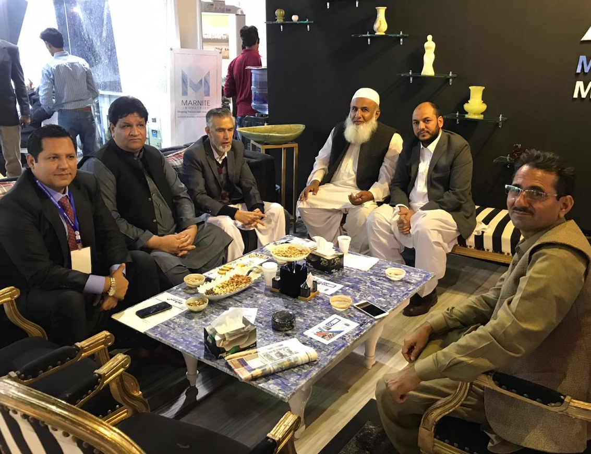
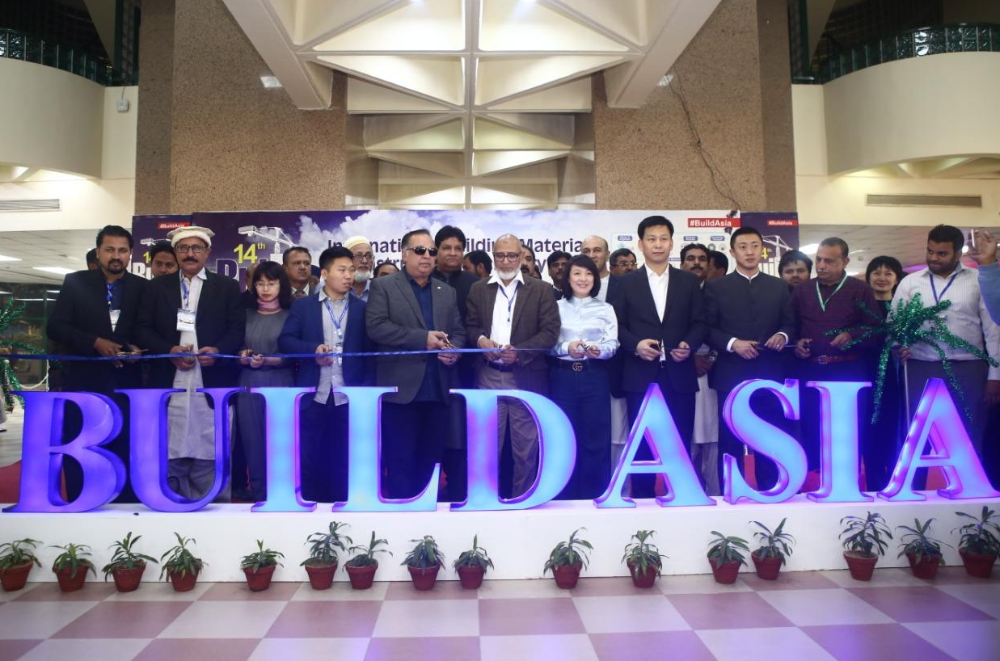

DG Mines & Minerals Department KPK, Mr. Muntazir Khan had a visit to 14th Build Asia Exhibition, 2018 along with Chairman Mian Gulzar Ahmad and Senior Vice Chairman Muhammad Bilal Khan of All Pakistan Marble Industries Association (APMIA), Sub Zonal Vice Chairman (Balochistan) Mr. Shabbir Ahmad and Mr. Asghar Khan Utmankhel, Executive Committee Member and Mr. Ilyas, Member APMIA.

Governor Sindh Mr. Imran Ismail visit at Expo Center, Karachi for 14th Build Asia Exhibition, December 2018.

Mr. Mian Gulzar Ahmad, Chairman APMIA and Mr. Sheikh Iftikhar Rasheed (Vice Chairman APMIA) has also joined him along with other Executive Committee Members.

