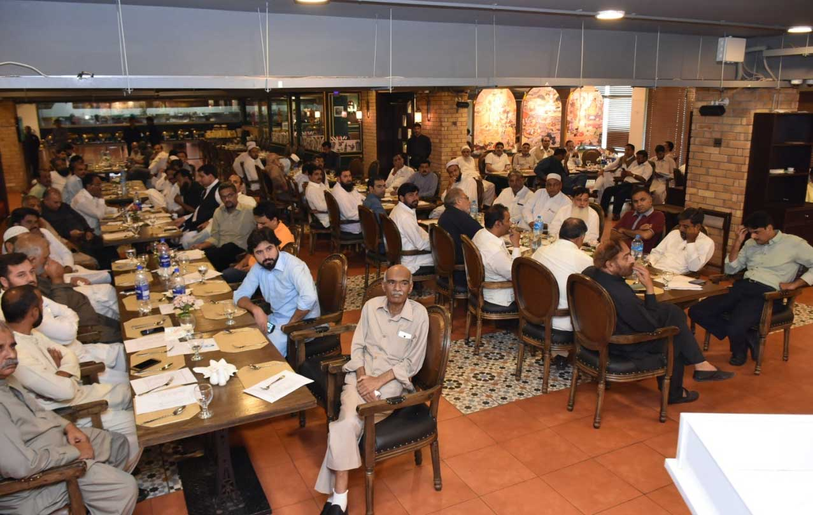
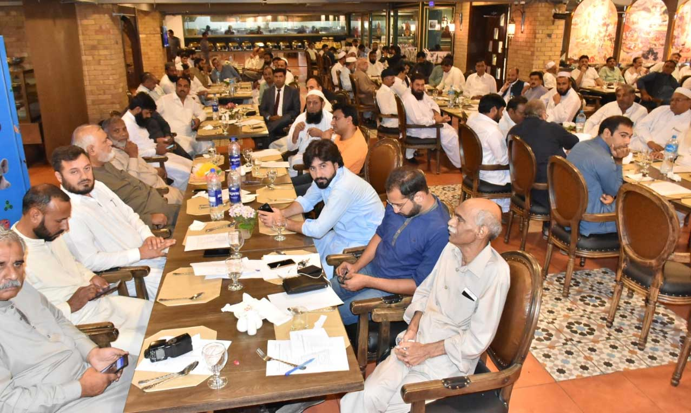
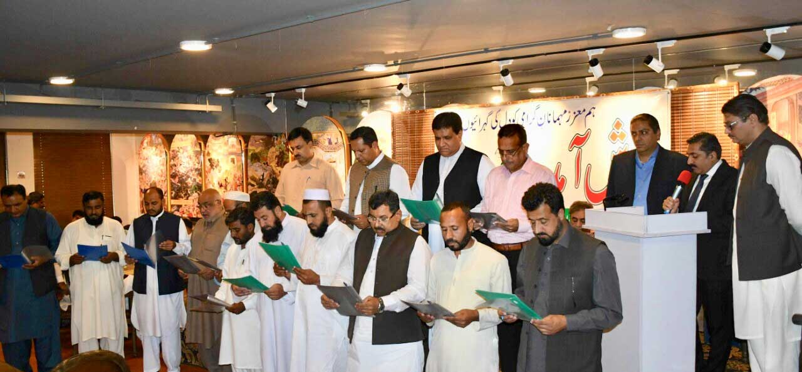
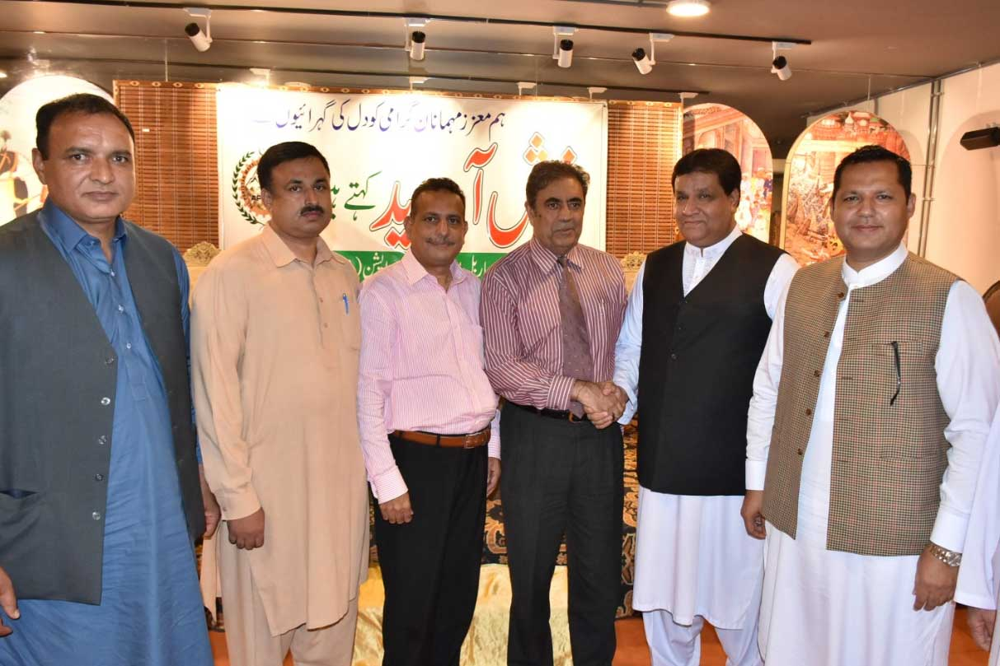
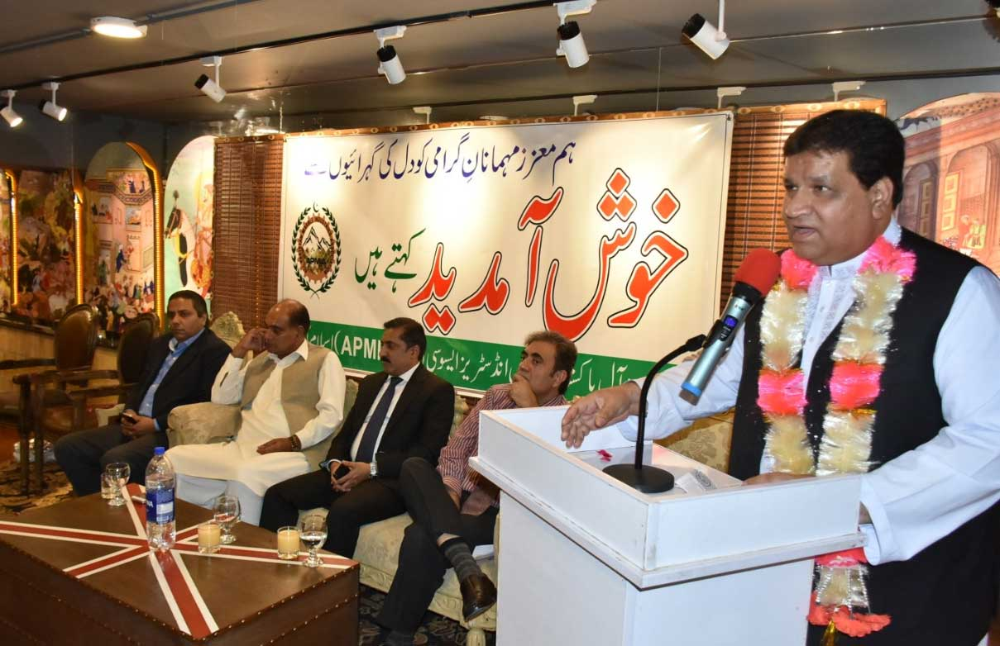
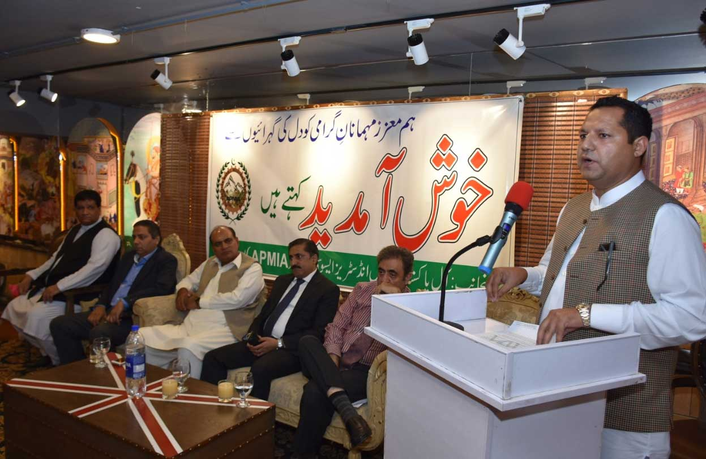
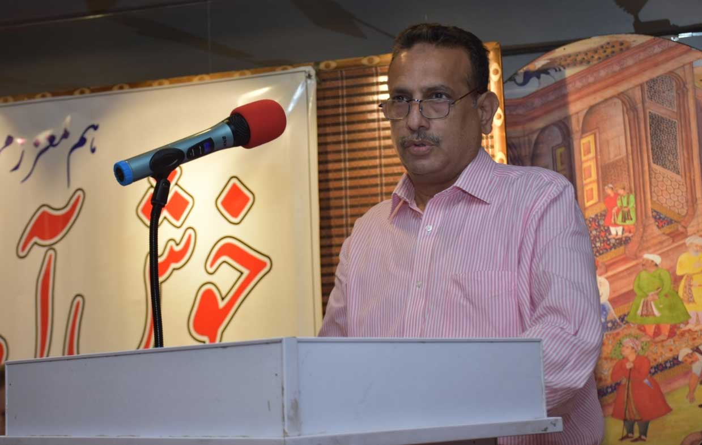
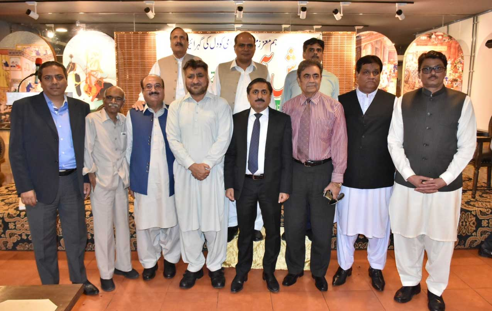

Annual General Meeting of All Pakistan Marble Industries Association for the year 2018-2019

Oath Taking Ceremony of Newly elected members of Central Executive Committee of All Pakistan marble Industries Association (APMIA),

Newly elected Top Office bearers of All Pakistan Marble Industries Association (APMIA) with nominated Governor Balochistan Dr. Ameer Khan Jogezai

Mr. Mian Gulzar Ahmed, Chairman All Pakistan Marble Industries Association addressing.

Mr. Muhammad Bilal Khan, Senior Vice Chairman All Pakistan Marble Industries Association addressing.

Mr. Sheikh Iftikhar Rashid, Vice Chairman All Pakistan Marble Industries Association addressing.

Former Chairmen of All Pakistan Marble Industries Association with nominated Governor Dr. Ameer Khan Jogezai and President Islamabad Chamber of Commerce & Industry Mr. Sheikh Amir Waheed

