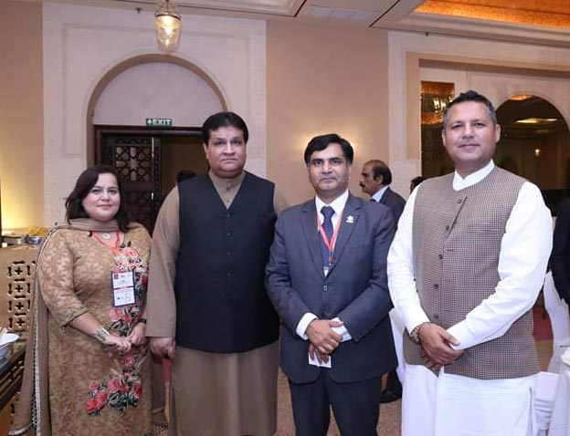

Chairman and Senior Vice Chairman APMIA attended CEO Summit and Book Launch of 100 performing CEOs, Leaders and Companies of Pakistan organized by CEO CLUB Pakistan in collaboration with Prime Minister’s Secretariat, Board of Investment, Government of Pakistan.

Razzaq Dawood, Asad Umer, Moeed Pirzada, Munner Kamal (Chairman Stock Exchange), SM Munir, Sardar Masood Khan (Presdient AJK), Dr. Ishrat Khan along with 50 ambassadors and 80 CEO’s of the Pakistan’s leading companies were persent at the event.

APMIA representatives shared their views regarding Pakistan’s Stone Sector. Furthermore, Pakistan is the land of opportunities and a destination of investment and they proposed the plan of activities for next five years regarding marble, granite, stone and mining sector.

