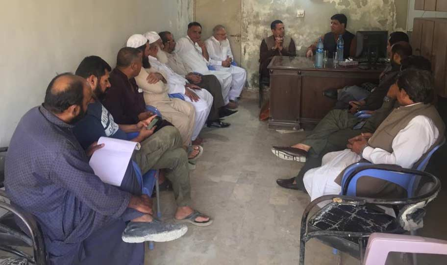

APMIA executives and representatives in APMIA Karachi office, chaired by Mian Gulzar Ahmed, Chairman APMIA, Muhammad Bilal Khan, Senior Vice Chairman, Atiq Ur Rehman Abbasi, Zonal Vice Chairman (South), following points were discussed in the meeting,

i) Local issues regarding construction of road, environment, street lights, lack of security and the issues of wastage storage including local relevant departments

ii) We should invite the bankers to open a bank on Manghopir Road to facilitate the businessmen nearby.

iii) Mian Gulzar Ahmed, Chairman APMIA told the members that all the stakeholders should work together to resolve the issues and committee for local issues should be made.

iv) We should invite all the factory / showroom owners under one roof to brief them the roles / services / benefits of APMIA, which will help us to increase the membership from South zone.

