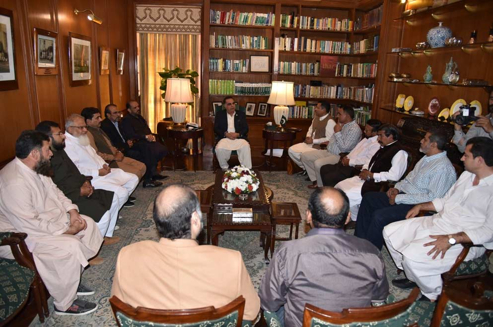

APMIA members met with Governor Sindh Mr. Imran Ismail in Karachi regarding Manghopir and Qasba dimensional stone industry. Following issues were discussed;

i) Road construction from Banarus upto sarjani should be completed quickly. Second, parallel road should be made workable for transport. Footpaths should be added to the master plan for pedestrian.

ii) Security issues; snatching issue closed to banks in Manghopir area were also discussed and we suggested to arrange a picket for rangers closed to the banks. We also agreed that we will donate cameras for vigilance in order to control the crime.

iii) Drinking water for laborers

iv) Assist us in the acquisition of our plots at marble city Karachi. Though he said that it’s not my area but I could request the Sindh govt.

v) We requested him to call Finance Minister for our exporters so they can share their genuine issues. He task Mr. Aziz Afridi to arrange a meeting with finance minister.

