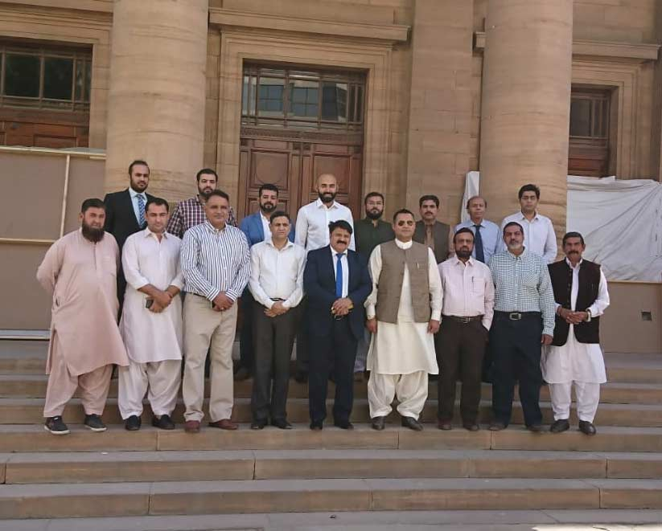

A delegation of our APMIA met representatives of SBP and bank Al Habib in Karachi regarding various issues. APMIA team raised following issues;

i) 5th mode of payment where credit time is given to exporters, to our utmost surprise SBP had already started it and they entertain those who have good track record. So those who want to send their export cargo without engaging banks, they can send through agreement which will be registered with the concerned bank.

ii) Conversion rebate; once remittance received there is always a gap between interbank and open market to bridge the gap, we requested SBP to issue us differential amount rebate. They didn’t agree to it, but requested us to submit the proposal for further approval.

iii) Our mining sector is out of negative list banks have been informed to provide leasing facilities to the dimensional stone industry. Islamic banking has also been started and musharika and mudaribaa is there for the clients.

iv) There is a finance committee and we need to send names for it who will work on behalf of our association. Our association will be informed through official letters from now onward.

v) Workshops will be arranged for awareness regarding new SBP rules and it is clearly informed if any bank is not complying send us the written complaint and we will ensure 100% compliance.

