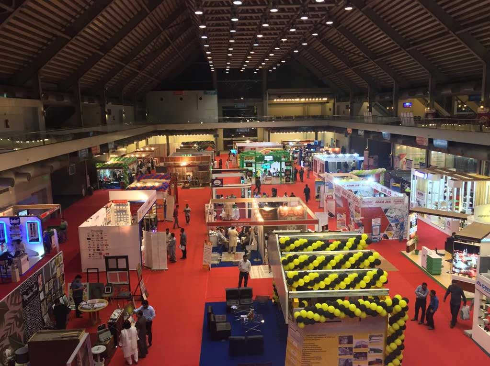
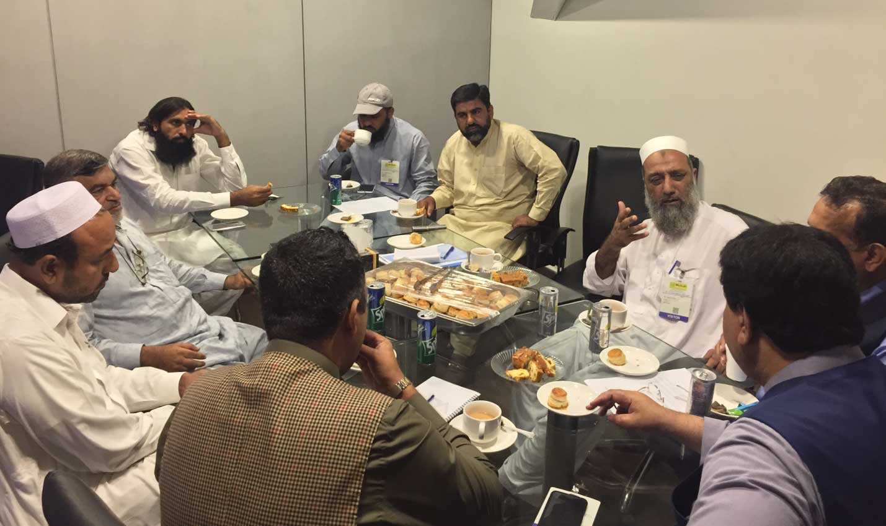
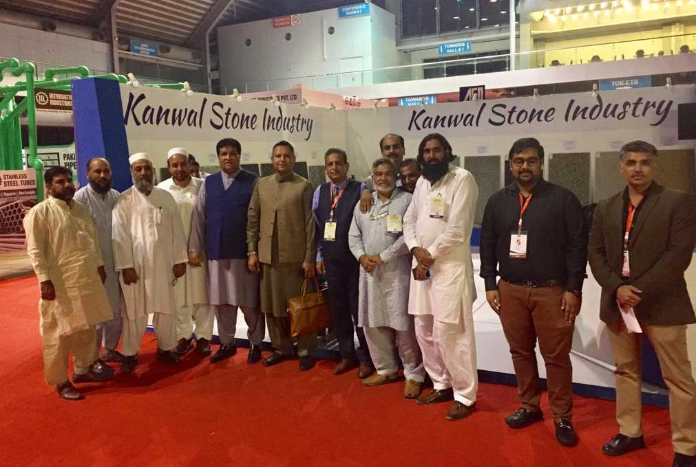

Chairman and Senior Vice Chairman APMIA including executives from Peshawar had a meeting at Lahore in Expo Center, Lahore. Following points were discussed;

1. i) Chairman APMIA told the executives that we should held the meeting for consecutive 7 days, it would be very result oriented.
1. ii) Rather than relying on government sources, we can contribute mutually and construct a ware house out of country.

iii) Improving the mining will help in increasing the export.

1. iv) To discuss and resolve the issues by the local members.
1. v) APMIA representatives met Mr. Salim Khan Tanoli, CEO of Fakt Exhibitions (Pvt.) Limited and Organizer of Build Expo, Lahore, to promote Stone products in Pakistani market and it was mutually decided that APMIA and Fakt Exhibitions (Pvt.) Limited will work together in coming exhibitions.

