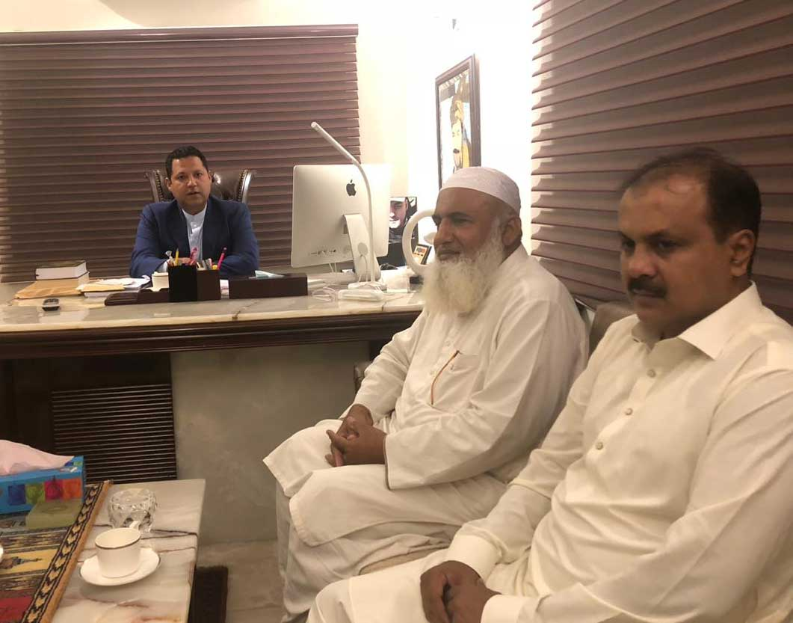

Mr. Muhammad Bilal Khan, meeting convened in Balochistan chapter with Mr. Shabbir Ahmed regarding issues faced by mine owners and industrialists. They decided to resolve the long ignored problem of our dimensional stone sector in Balochistan and also decided to meet CM Balochistan and Secretary Mines on priority basis.

