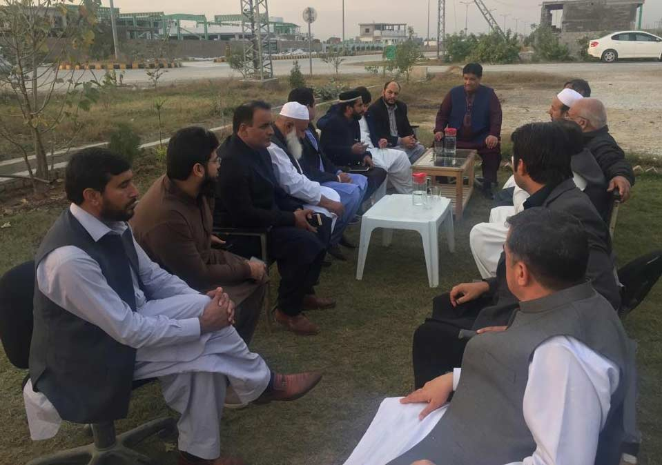
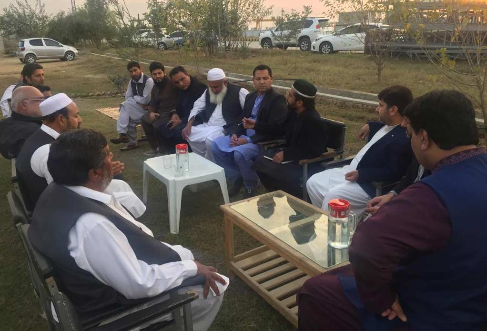

Meeting of APMIA representatives was conducted with PASDEC’s site office in Marble City, Risalpur.

i) Major issue in Marble City, Risalpur which was highlighted is the transmission of electricity to the factory owners.

ii) The allottees are also facing the issues regarding the disposal of sludge which should be resolved on priority basis.

iii) Furthermore, Chairman and other executive members of APMIA assured to try to resolve the problems of marble city and will raise their issues on every relevant forum.

