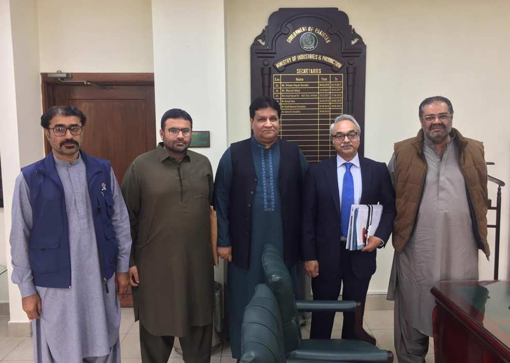

A Meeting of Chairman APMIA, Mian Gulzar Ahmed including Ex-Federal Minister Mr. Humayun Kurd, Mr. Gul Zaman Shahwani and Mr. Shoaib Sultan with Secretary Industries & Production, Mr. Azhar Ali Chaudhary.

The points of the meeting are as follows,

i) Secretary Industries instructed CEO PASDEC to visit the mine of Mr. Humayun Kurd in Balochistan and officially mention the reason of the refusal of his exemption because without visiting the site, there is no logical reason to reject the exemption.

ii) He mentioned that PASDEC is a public limited company, regulatory tasks should not be handled by PASDEC.

iii) Secretary Industries further told Chairman APMIA that a framework will be made that CEO PASDEC should be from the marble sector in order to enhance this industry.

