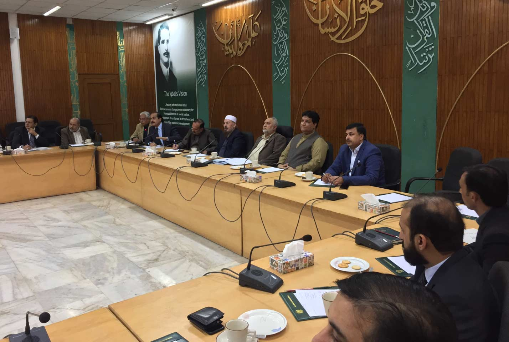
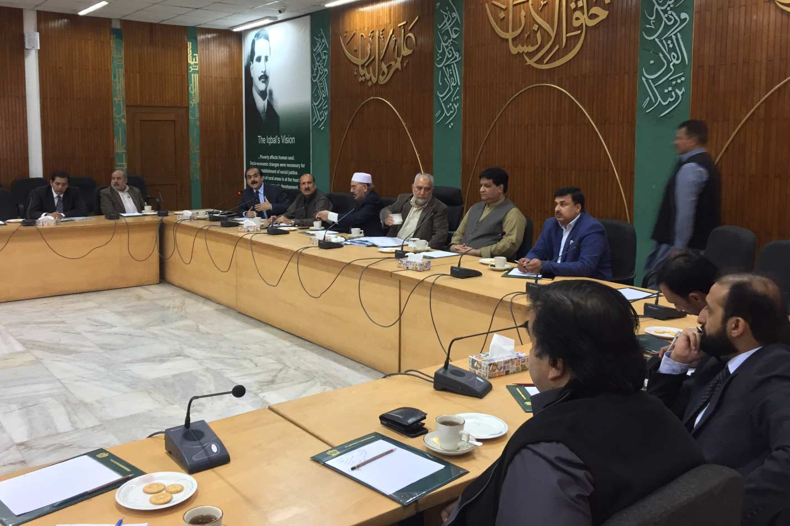

Meeting was held at Ministry of Planning, Development & Reforms, Islamabad, Chaired by the Joint Secretary including Chairman Mian Gulzar Ahmed, Zonal Vice Chairman (North) Muhammad Afzal Shahid APMIA, CEO , GM SMEDA, Government officials from all provinces and Federal ministries, Mr. Shahid Ur Rehman (Former Chairman APMIA) was also in the meeting including representatives from mining Association’s;

Following points were highlighted by APMIA;

i) We should spread awareness regarding the benefits of our industry by inviting businessmen / investors so they can become aware of the stone sector, investment opportunities and attractions.

ii) PASDEC has failed to play their role in development and promotion of mining sector.

iii) PASDEC should be further strengthened and should be export targets for increasing exports to greater extent.

iv) Regulatory framework should be further improved.

v) Government should support the mine owners to resolve their local issues. 6. Invite mine owners and brief them regarding mechanize mining and latest technology by showing them videos / photos, that will help the miners positively.

vi) To provide mechanize machinery on lease on the installments on down payment of 5% rather than providing them machinery on rent.

vii) Chinese investors are investing in mining sector with latest machinery, we should propose them to include our unskilled labor so they can learn to operate latest machinery. Half of the labor should be from Pakistan so they can be skilled.

viii) As our export is decreasing, we should identify the basic problems that will help in resolving the export related issues.

ix) APMIA has assured the quorum that we will provide full support and cooperation.

x) Chairman APMIA told the ministry officials to provide us the time so we can discuss the issues regarding stone industry with our members so we can officially submit our proposals / recommendations/ suggestions with the mutual consent of all APMIA members.

