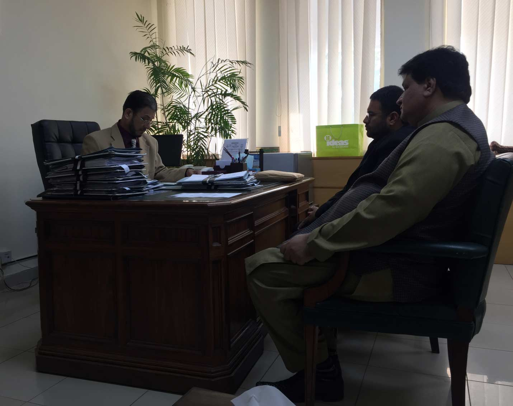

Meeting held by APMIA representatives including Chairman, Mian Gulzar Ahmad, Zonal Vice Chairman (North), Muhammad Afzal Shahid and Shoaib Sultan with Additional Secretary Industries & Production. Following achievements were made in the meeting;

i) Issue of Mr. Humayun Kurd regarding his machinery has been resolved by Ministry of Industries & Production. The written order from Secretary Industries has been sent to PASDEC to release his machinery.

ii) Secretary Industries also approved to remove the private sector nominee from the issuance of exemption certificate, Chairman APMIA will only verify and attest the exemption documents. They will intimate PASDEC as well.

iii) Case of Mr. Shoaib Sultan from Popular Marble regarding PASDEC’s violation of Rental agreement has been forwarded to the Secretary and will be resolved within the 15 days.

