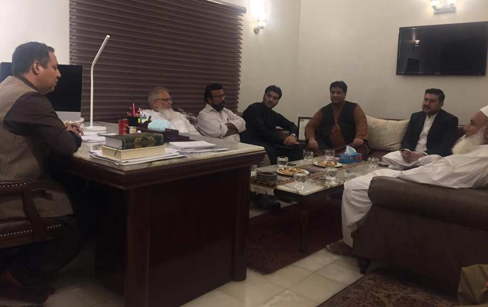

Second meeting including Chairman, Senior Vice Chairman and other executive members of APMIA was conducted with Mr. Allauddin Marri, member APMIA (Presidential candidate of FPCCI for the year 2019) including Mr. Mian Zahid Hussain, Senior Vice Chairman of Businessmen Panel Pakistan (BMP).

Mr. Allauddin Marri briefed his visions / objectives / plan of activities regarding promoting marble sector, especially in mining sector in Balochistan.

