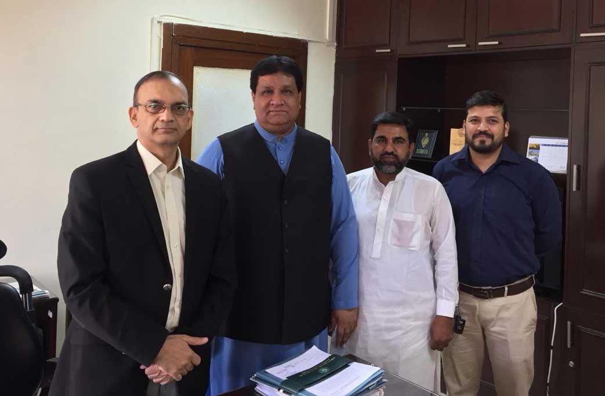

Following meetings were conducted by the Mr. Mian Gulzar Ahmed, Chairman APMIA

i) Meeting with Mr. Hasan Nisar, Secretary of Ministry of Energy Power Division, Islamabad, following points were discussed;

a) Minerals potential in Pakistan was discussed, we can utilize this potential for the betterment of economy, employment and export.

a) Electricity issues regarding marble City, Risalpur

b) Transmission issues to the grid station of Risalpur from Mardan

c) 12 poles are required

ii) Meeting with Mr. Waseem Mukhtar, Managing Director of Pakistan Electric Power Company (PEPCO), following points were discussed;

a) Chairman APMIA conveyed to M. PEPECO that Marble factory owners are facing very serious problems in Marble City, Risalpur regarding electricity.

b) Working has been stopped since 2 years, it should be resolved.

c) NOC from Army was received on 05-07-2018

d) Managing Director PEPCO assured that the issue will be resolved till December, 2018

