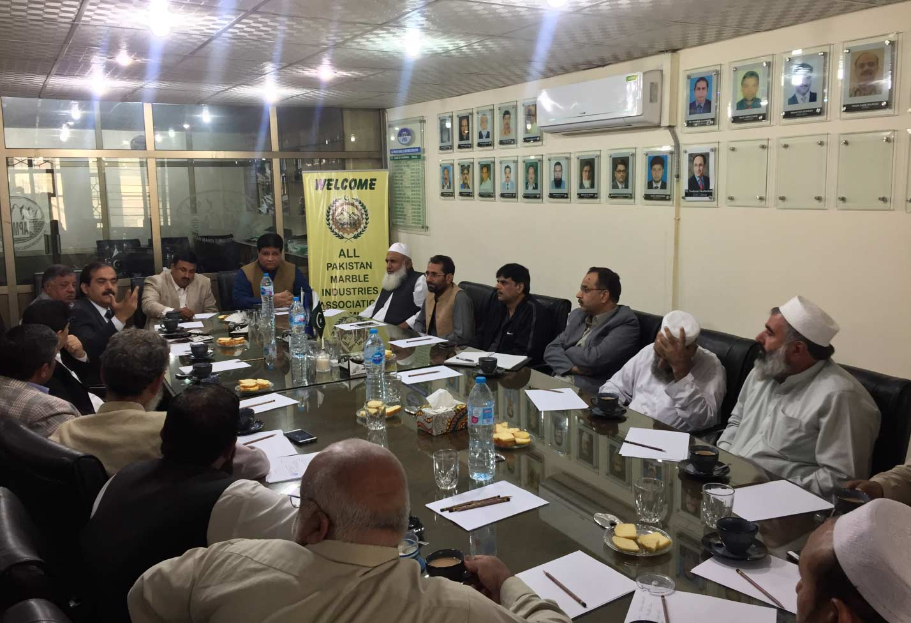
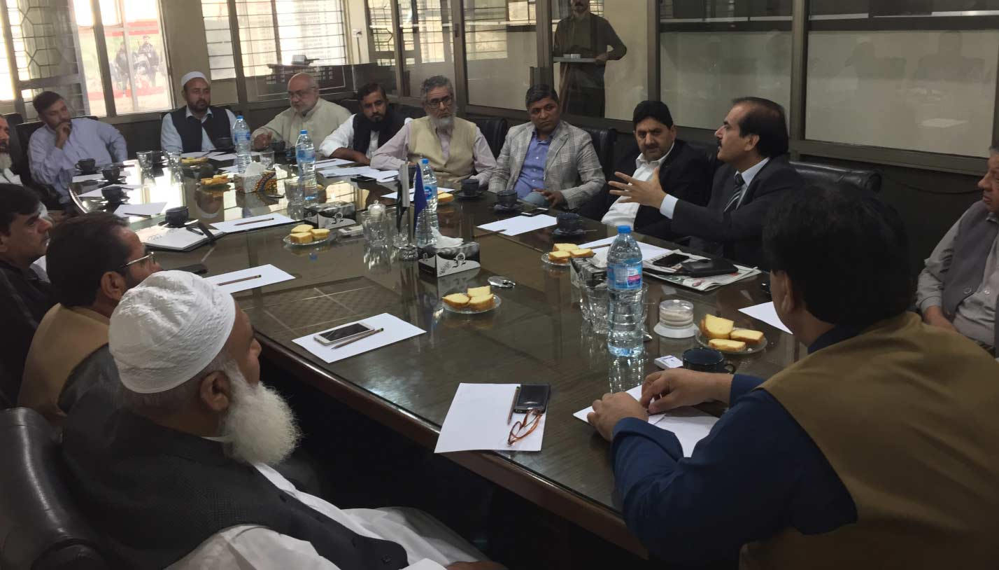
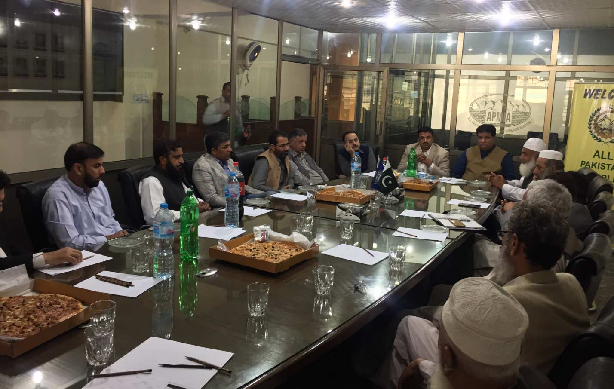

First meeting was conducted with Mr. Javed Khattak, General Manager, SMEDA with Chairman Mr. Mian Gulzar Ahmed, Zonal Vice Chairman (North) Mr. Muhammad Afzal Shahid and executive committee and senior members of APMIA.

The points that were discussed in the meeting are as follows,

i) GM SMEDA mentioned APMIA representatives that dimensional stone including Marble/ Granite / Onyx / Mining etc has the top priority which can help in the growth of our country. Further, he mentioned the following points which are most important;

a) Financial situations

b) Technology endowment funds

c) Technology up gradation and business module

d) Human Resource development

e) Regulatory reforms

f) 50 percent of the cost of machinery for mining and processing can be provided by SMEDA.

g) Funds announcement for FATA will be made approx 5 to 7 million USD

ii) APMIA representative mentioned that internal marketing strategy should be strong including the supply chain between quarries and export.

iii) Industry ERP should be initiated and implemented by SMEDA.

iv) GM SMEDA offered APMIA to make a permanent advisory committee including federal and provisional government and quarterly meetings should be held.

v) APMIA proposed that a committee including representatives from APMIA, PASDEC, SBP, SMEDA and Mines and Minerals Department should be formed and they all should be on one page so a committee can perform and make the meetings of the committee result oriented.

vi) RBC should be made in Muslim Bagh, Gwadar and Khuzdar and SMEDA should conduct skill development / capacity building workshops on quarterly basis.

vii) Furthermore, APMIA mentioned that mechanize machinery is a major demand in Pakistan, a successful model should be made on one quarry mutually to compete international standard.

viii) Chainsaw / Wire saw / Excavator should be provided on rent, in this regard GM SMEDA told that APMIA should provide a proposal to SMEDA.

ix) GM SMEDA conveyed to all members that expert engineers can conduct a seminar on electricity in which electricity consumption can be reduced.

x) Further he mentioned that SMEDA is willing to corporate with APMIA in any issues regarding stone sector.

xi) Strong supply chain should be made between manufacturer, wholesaler and retailer.

A meeting was conducted with Mr. Tahir Khan, representative of GIZ (a company affiliated with European Union) with Chairman Mr. Mian Gulzar Ahmed, Zonal Vice Chairman (North) Mr. Muhammad Afzal Shahid and executive committee and senior members of APMIA.

Following points were discussed in the meeting;

i) Tahir Khan told APMIA representatives that GIZ is providing training on skill development including skills, knowledge and marketing attitude in started from Jahangira, Nowshera in 2016.

ii) GIZ is trying to impose European standards in Pakistan and APMIA can provide their demands as well.

iii) APMIA representatives mentioned that recovery and material prevention, this base should be followed.

iv) We should skill the unskilled labor including providing them the material handling skills.

