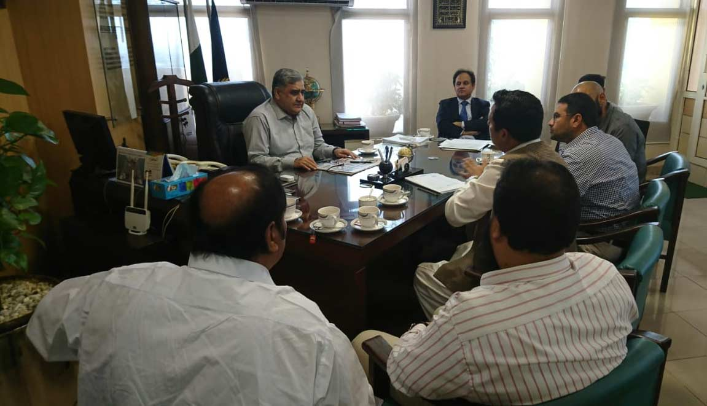
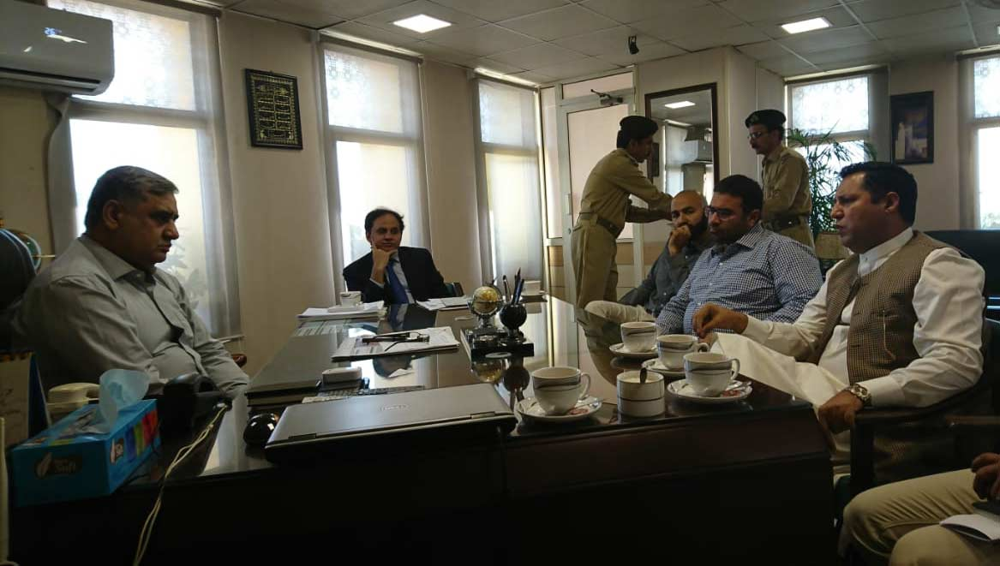

Meeting of Mr. Saqif Saeed, Chief Collector, Exports and APMIA representatives including Mr. Muhammad Bilal Khan, Senior Vice Chairman APMIA and convinced him along with his collector export to accept our minimum values for export. After due consultation, they agreed the formula and accepted what we presented it to them. We have requested the A/C customs to issue us the letter of endorsement, so none of our exporter in future is harassed by custom officials. Shabir Memon sahib GD is also completed and special thanks to him who resisted the pressure and remained calm during unnecessary delay.

