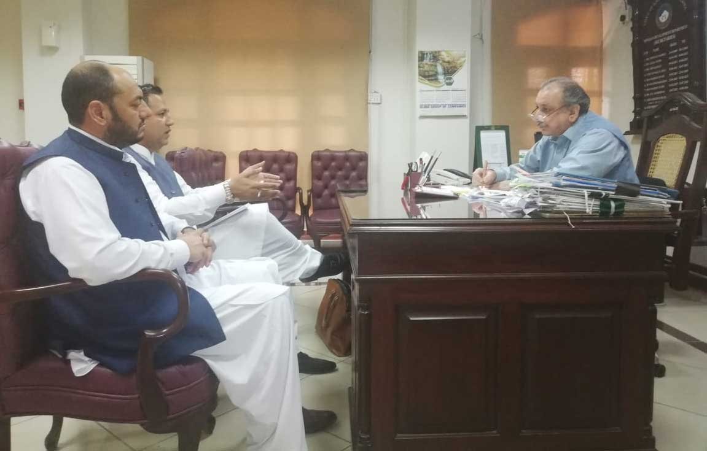

Mr. Muhammad Bilal Khan, Senior Vice Chairman including executive committee members including Mr. Shakir Ullah, Mr. Asghar Khan Utmankhel of All Pakistan Marble Industries Association and they had a meeting with Secretary Mines and Minerals Development Department of KPK in Peshawar, and informed him regarding the issues faced by the miners. They suggested different options which the Secretary appreciated at the end of the meeting and he made a commitment to invite the APMIA representatives in the next meeting.

Second meeting conducted with the Senator Mr. Hilal Khan regarding dynamite for the miners of Mohmand Agency, KPK and he promised the ammunition will be available to the miners within a week time. Ammunition issue will be resolved with the permits.

