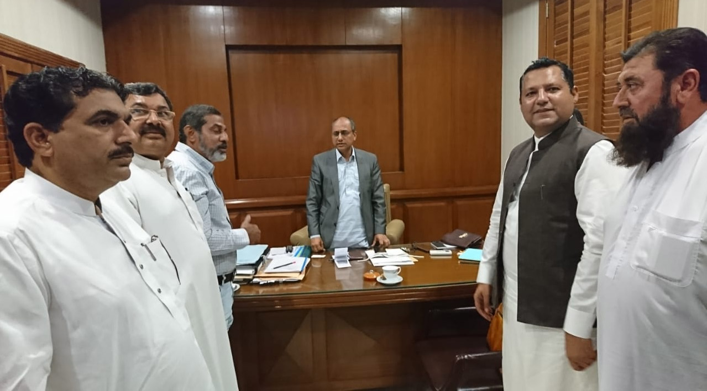

Meeting with the Honorable Provincial Minister of Sindh for Local Government, Public Health Engineering and Rural Development, Mr. Saeed Ghani and APMIA representatives under the chairmanship of Mr. Muhammad Bilal Khan, Senior Vice chairman including Executive Committee Members APMIA, Mr. Azeem Chughtai, Mr. Mustafa Naseeb, Mr. Sardar Nazir, Mr. Noman sultan, Mr. Haji Iqbal and Syed Faraz, Office Secretary APMIA (Southern zone).

Following issues were to discussed in the meeting which our marble industry is facing,

i) Storage of slugs.  
 ii) Sanitation.  
 iii) Water supply for industry.  
 iv) Water supply for human consumption.  
 v) Enforce DMC services, maintains & improves infrastructure.  
 vi) Trade license fee (Reduce).  
 vii) Environmental issues.  
 viii) Law and order.

