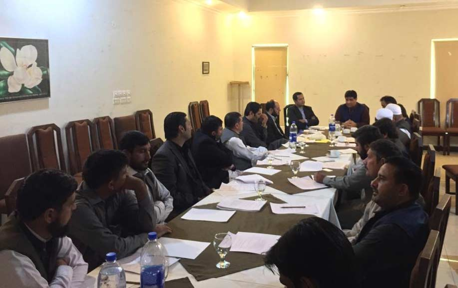
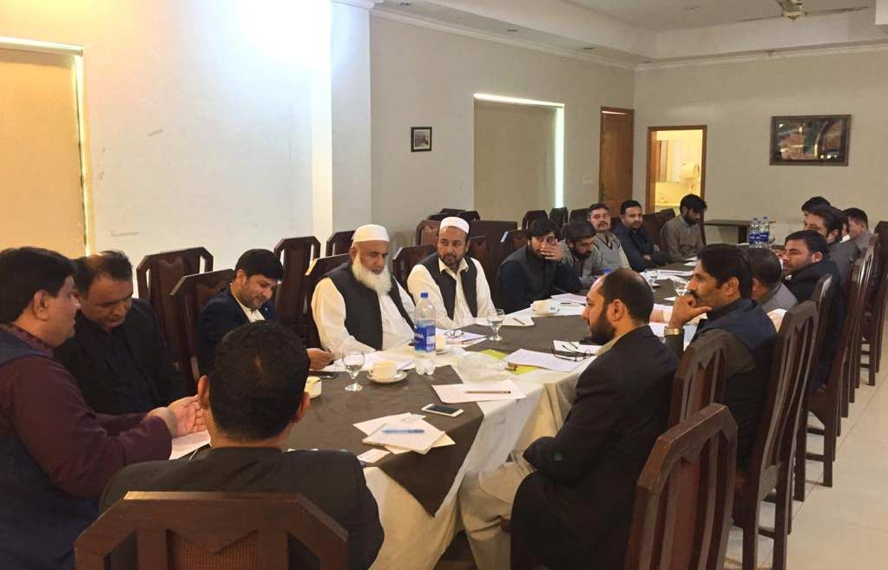

Meeting of APMIA representatives including Chairman Mian Gulzar Ahmed, Senior Vice Chairman Muhammad Bilal Khan, Zonal Vice Chairman Atiq ur Rehman Abbasi (South), Sub Zonal Vice Chairman (Balochistan Region), Haji Shabbir Ahmed and other executives with the local factory owners of Small Industrial Estate, Mardan, Marble City, Risalpur and mine owners from FATA region and Buner. Following were the points which were discussed in the meeting;

i) All the local factory and mine owners of KPK region appreciated the active role of newly elected top office bearers and executive committee members for the betterment of our industry.

ii) It was briefed by the APMIA representatives to the quorum that association plays the role of advocacy between government and private sector stake holders and all stakeholders should share their problems on APMIA platform including development of mechanise mining, marketing techniques, processing issues with government department and export related issues.

iii) It was mentioned by APMIA members that Mardan has the second potential industries area after Karachi and according to our survey 10 million ton raw material is extracted from KPK.

iv) Issues regarding explosives on mines in Mohmand Agency and the mine owners have mentioned that according to their requirement, current supply of explosives for mining which government is providing is not enough and APMIA representatives told the miners that this issue has already been raised to the relevant departments and we are trying to resolve this issue within the time period of 15 days.

v) Mine and factory owners from Buner shared that local environment departments in District Buner has sealed a lot of Factories and they are facing labor act issues as well.

vi) It was also mentioned by APMIA representatives that production of marble is directly linked with export and representation from APMIA will be made on every relevant department will be made to fill the communication gap.

vii) APMIA members asked all factory and mine owners that to convey our issues to the government level, we should be on one page. And we can demand from the government that all the government projects regarding marble should be given on behalf of APMIA, so APMIA can distribute the project amongst its members according to their capacity.

viii) It was highlighted in the meeting that mining departments should provide the protection to the mine owners and rescue centers should be focused on priority.

ix) APMIA representatives told the quorum that a meeting was held between APMIA and State Bank of Pakistan Officials in Karachi and it has been conveyed to the SBP Officials for funding SME’s.

x) PASDEC’s performance in stone industry was also highlighted that they should invest in human development and APMIA representatives from Jahangira, Nowshera told the members that GIZ (a company affiliated with European Union Council) is already working in Jahangira to facilitate the unskilled labor.

xi) Local factory owners asked APMIA to conduct awareness sessions, seminars etc and industry related acts should be raised and provide awareness to the people working in this sector regarding trade.

xii) APMIA representatives requested to all factory and mine owners to participate in International Stone Expo to be held in Karachi from 15-17 December, 2018 so promote the local products.

