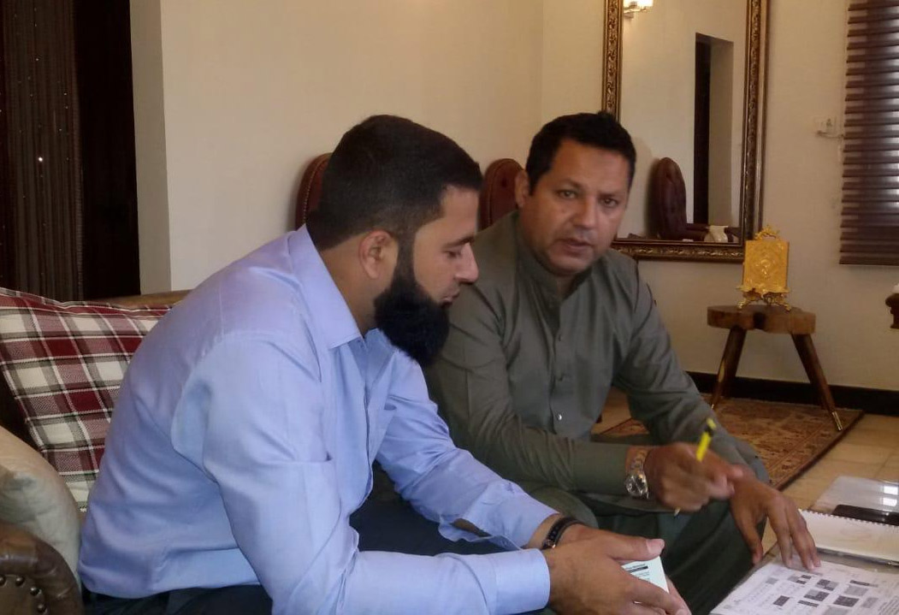

APMIA representatives had a meeting with the organizers of 14th Stone Fair Asia International Exhibition in Karachi, which will be held from 15 to 17 December, 2018. They have negotiated the rates of stalls to make it more economical for APMIA’s members and it was decided in the meeting that the members of APMIA will get 3 x 3 stall for Rs. 25,000/- (all inclusive of taxes), otherwise the rates are very high for stalls.

