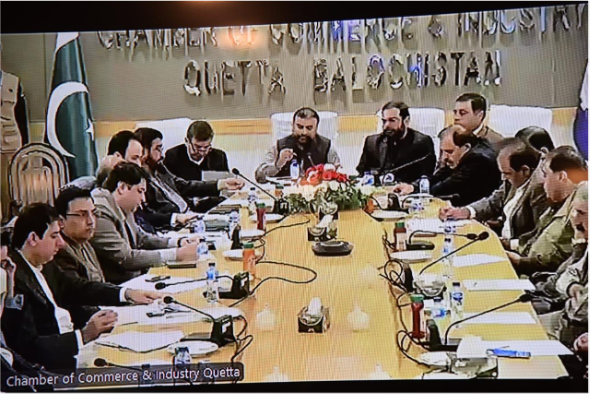

Chairman APMIA, Muhammad Bilal Khan, held an online Zoom meeting with the Chief Minister of Balochistan, Mr. Sarfraz Bugti, at Federation House, Karachi. During the meeting, the Chairman discussed security issues in the mining sector and the illegal restrictions on granting leases in Chagai. Other mining-related issues were also deliberated upon during the meeting

