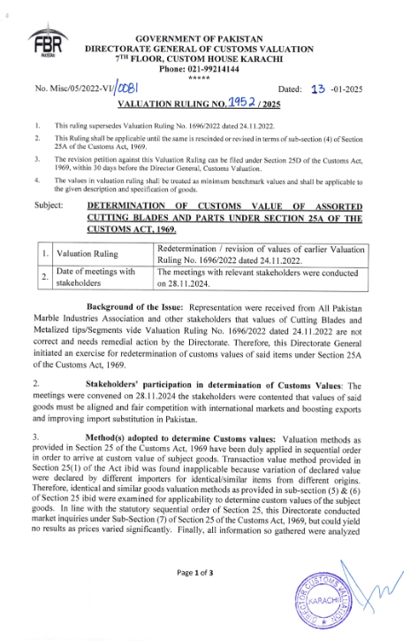
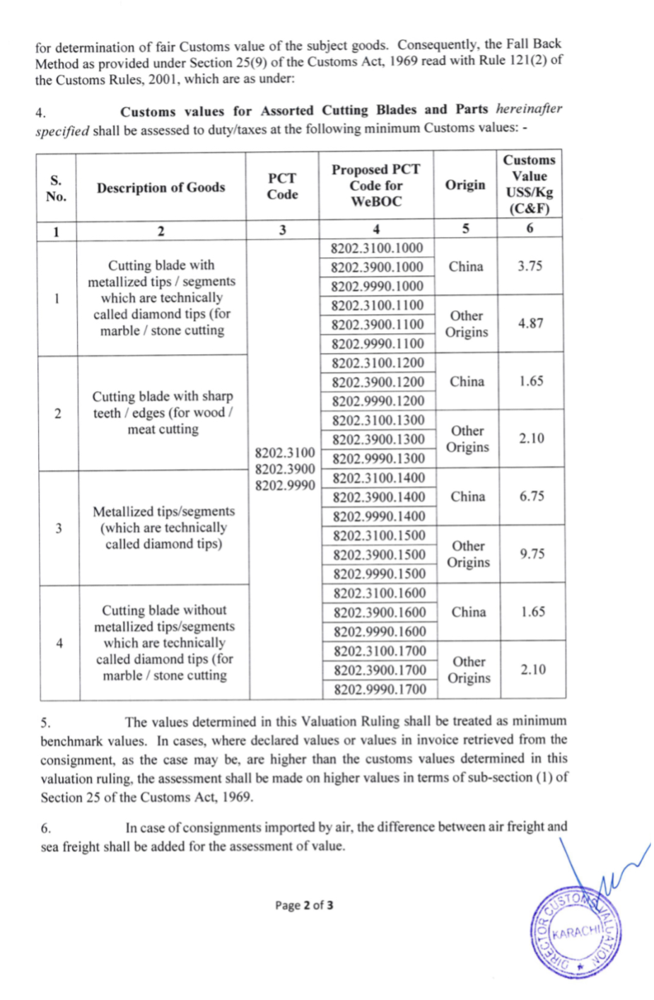
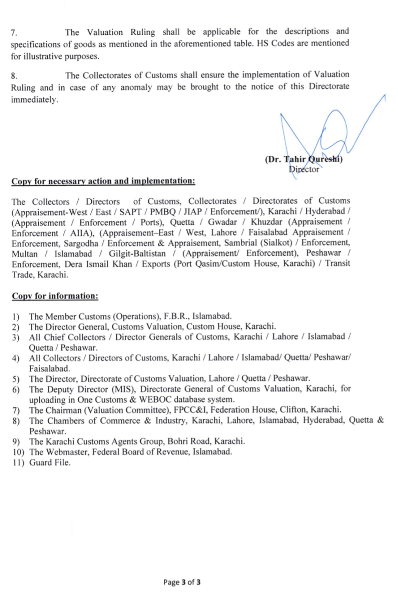

By the grace of Allah and through the efforts of Chairman APMIA, Muhammad Bilal Khan, and his team, a significant milestone has been achieved in reducing the prices of imported blades and segments. This is a very important and positive development for our sector.

We hope this will encourage our suppliers of segments and blades to lower their prices, benefiting our dimension stone processors

