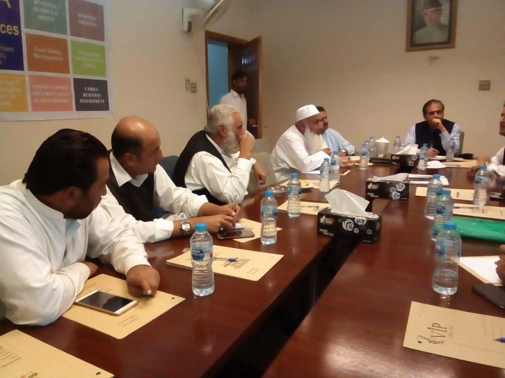
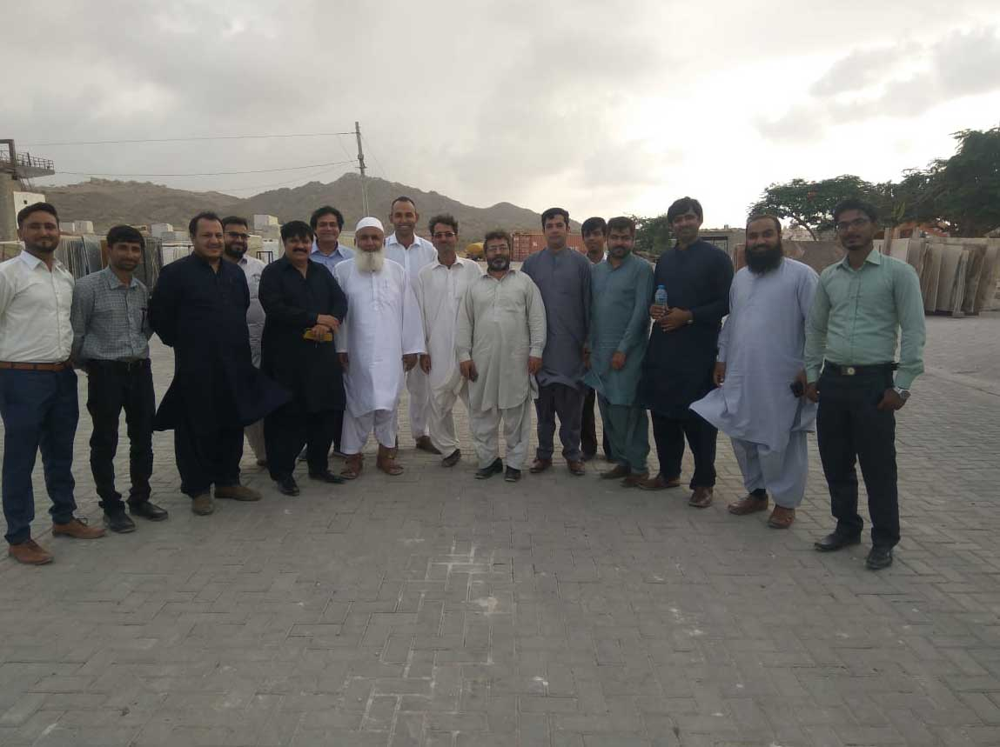
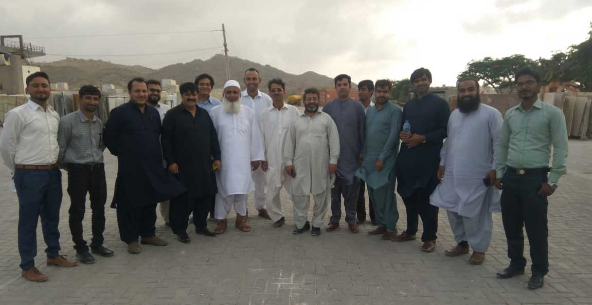

1. i) Shabbir Ahmed (Sub Zonal Vice Chairman-APMIA) has attended the workshop at Muslim Bagh with SMEDA and local mine owners, during discussion following issues are raised,
1. a) Regulatory
1. b) Technology / Technical supports
1. c) Financial Support
1. d) Infrastructure from chrome city
1. e) Explosive material availability for mining.

iii) Mr. Shabbir Ahmed (Sub Zonal Vice Chairman – APMIA) meeting with SMEDA at Marble City, Gaddani, Lasbela, Balochistan

